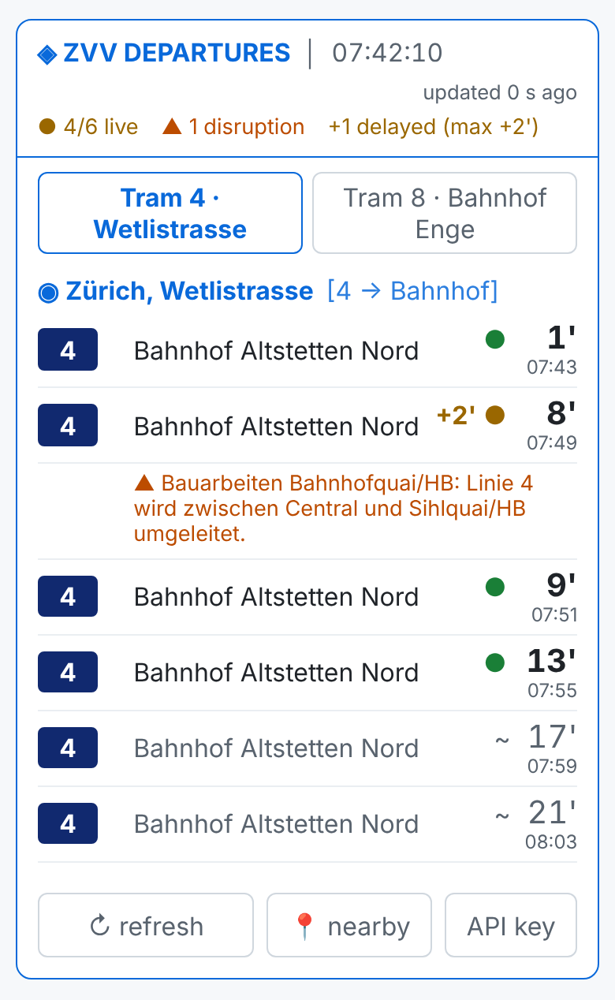
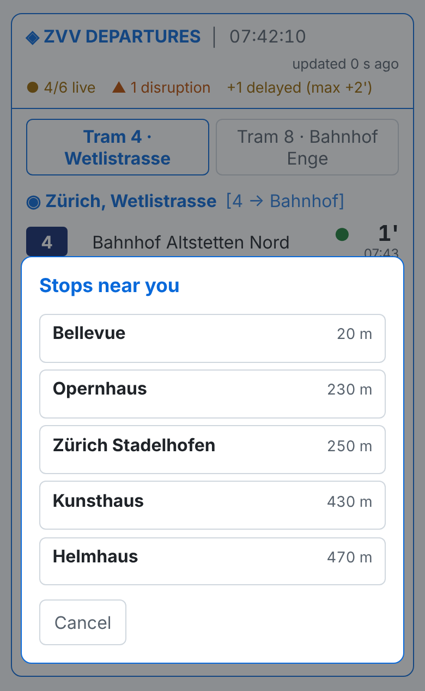
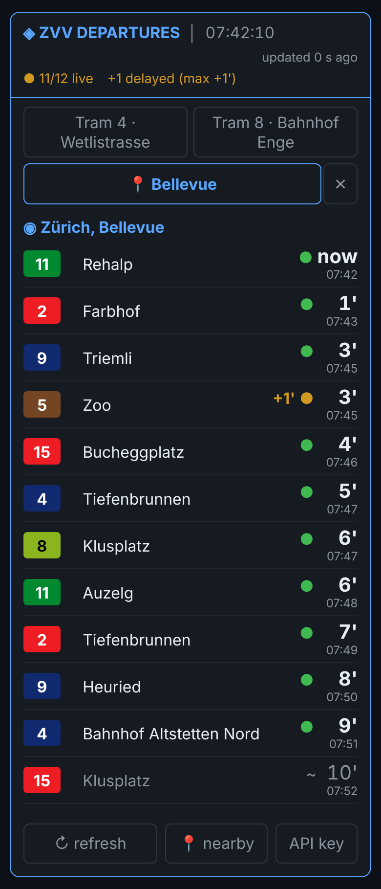

# ZVV Departures

A small, dependency-free web app that shows live departures for Zurich (ZVV)
public transport stops, using the Swiss
[OJP 2.0 API](https://opentransportdata.swiss/en/cookbook/ojp/) from
opentransportdata.swiss. It runs entirely in the browser: there is no backend,
no build step and no third-party JavaScript.

It is built around a commute: a small set of hardcoded "boards" (stop + line +
direction), with the right one picked automatically by time of day.

## Screenshots

| Commute board | Stops near you | Nearby board, dark mode |
| :---: | :---: | :---: |
|  |  |  |

The screenshots use sample data (see
[Regenerating the screenshots](#regenerating-the-screenshots)).

## Features

- **Live departure board** with countdowns (`now`, `4'`, or `HH:MM` for
  departures an hour or more away), the forecast clock time, and a marker for
  whether the time is real-time (`●`) or timetable-only (`~`).
- **Tram line colors**: Zurich tram line numbers are shown in their official
  VBZ line color (defined at the end of `style.css`). Buses and cancelled
  departures keep the plain outlined badge.
- **Status at a glance**: a summary row shows how many departures have live
  data, plus delays (with the maximum delay), cancellations, skipped stops and
  disruptions.
- **Disruption messages** (SIRI situations) are shown inline below the first
  departure they affect.
- **Line and direction filters** per board, e.g. "only tram 4 towards
  Bahnhof". If the direction filter matches nothing, the board lists the
  destinations that line actually serves from that stop, so a typo is easy to
  fix.
- **Time-of-day default board**: before noon the morning board is shown, after
  noon the evening board. Picking a tab by hand overrides this for the session.
- **Polite polling**: only the visible board is refreshed, every 30 s, and only
  while the page is visible. Failures back off exponentially (up to 5 minutes)
  and respect `Retry-After`. Manual refresh is limited to once per 5 s and
  never skips a backoff.
- **Stale-data warning** when the last successful update is older than 90 s.
- **Nearby stops**: the "📍 nearby" button uses your location to list the five
  closest stops within 1 km, with their distance. Picking one opens a
  temporary, unfiltered board for that stop as an extra tab (up to 12
  departures); its ✕ closes it again. The tab is not kept across reloads.
- **Installable** as a home-screen app (web app manifest, Apple touch icon,
  standalone display mode).
- **Light and dark mode** follow the system setting.

## Getting an API key

1. Create a free account at the
   [opentransportdata.swiss API manager](https://api-manager.opentransportdata.swiss/).
2. Subscribe to the **OJP 2.0** API and create a key (token).
3. Open the app and paste the key into the dialog that appears on first start.
   The "API key" button in the footer lets you replace or forget it later.

The free tier allows 50 requests per minute and 20,000 per day. At one request
every 30 s for the visible board, the app stays well within that.

## Deploying

Serve the repository root as static files from any HTTPS host (GitHub Pages,
Netlify, an S3 bucket, a home server, ...). There is nothing to build. HTTPS is
recommended because home-screen installation and some browser features require
a secure context.

## How to fork with Claude Code

You can have [Claude Code](https://claude.com/claude-code) set up your own
copy, with your own stops, published on your own GitHub Pages site:

1. Click **Fork** at the top of this repository's GitHub page to copy it to
   your account.
2. Open your fork in Claude Code: clone it and run `claude` in the folder, or
   choose the repository at [claude.ai/code](https://claude.ai/code).
3. Paste this prompt:

```text
This repository is my fork of a small ZVV departures web app (plain HTML, CSS
and JavaScript, no build step; see README.md). Please make it my own version:

1. Ask me which departure boards I want. For each: the stop (e.g.
   "Zürich, Paradeplatz"), the line or lines (empty for all), the direction
   (a word from the destination name, e.g. "Bahnhof", or empty for all), and
   from which hour of the day it should be the default board. Also ask what
   the app should be called on my home screen.
2. Replace PRESETS in js/app.js with my boards, and update the app name in
   index.html, manifest.webmanifest and the README title. Leave everything
   else as it is.
3. Serve the app locally (python3 -m http.server) and check in a browser that
   it loads without console errors. Do not ask for my OJP API key: I will
   enter it in the app myself, and it must never be committed.
4. Commit the changes to the main branch and push.
5. Publish the site with GitHub Pages from the main branch, root folder, for
   example with: gh api -X POST repos/OWNER/REPO/pages -f "source[branch]=main" -f "source[path]=/"
   If you cannot do that from here, give me the exact steps in the
   repository's Settings → Pages instead.
6. Tell me the site's URL (https://USERNAME.github.io/REPO/), how to add it
   to my phone's home screen, and where to get an OJP 2.0 API key.
```

Once the site is live, open it on your phone, add it to the home screen, and
paste your API key (see [Getting an API key](#getting-an-api-key)). If a board
says that no stop was found, or shows no departures, ask Claude to adjust that
board's stop name or direction.

## Development

### Running locally

The app uses ES modules, so it must be served over HTTP rather than opened as a
`file://` URL. Any static file server works, for example:

```sh
python3 -m http.server 8000
# then open http://localhost:8000/
```

### Regenerating the screenshots

The screenshots in this README are made by
[`docs/screenshots/render.js`](docs/screenshots/render.js). It opens the app in
a headless Chromium at phone size and fakes everything outside the page: the
OJP responses (sample departures, a disruption, five nearby stops), the
location, and the clock (07:42:10 in Zurich). No API key or network access is
needed, and the pictures look the same each run. Regenerate them after
changing the UI:

1. Install a current LTS release of [Node.js](https://nodejs.org/) and Python 3.
2. From the repository root, install Playwright and its Chromium browser.
   `node_modules/` is ignored by git, and no `package.json` is created:

   ```sh
   npm install --no-save --no-package-lock playwright
   npx playwright install chromium
   ```

3. Serve the app on port 8765 (the script expects that port) and leave it
   running:

   ```sh
   python3 -m http.server 8765
   ```

4. In a second terminal, from the repository root, render the screenshots:

   ```sh
   node docs/screenshots/render.js
   ```

   This overwrites `board.png`, `nearby-stops.png` and
   `nearby-board-dark.png` in `docs/screenshots/`. Pass a directory as an
   argument to write them somewhere else instead.
5. Check the new images (for example with `git diff --stat` and an image
   viewer), stop the server with Ctrl+C, and commit the PNGs.

To change what the screenshots show, edit the sample data near the top of
`render.js`.

## Configuration

Boards are defined in `PRESETS` at the top of [`js/app.js`](js/app.js):

```js
{
  id: 'morning',
  label: 'Tram 4 · Wetlistrasse',   // tab label
  stopName: 'Zürich, Wetlistrasse', // resolved to an OJP stop ID on first use
  lines: ['4'],                     // empty array = all lines
  direction: 'Bahnhof',             // substring of the destination; '' = any
  defaultFromHour: 0,               // board is the default from this hour on
}
```

The board with the latest `defaultFromHour` that is not after the current
Zurich hour is shown by default.

Other tunables live next to it: `REFRESH_SECONDS` (poll interval),
`MIN_REFRESH_SECONDS` (manual refresh limit), `STALE_AFTER_SECONDS`,
`DEPARTURE_LIMIT` (rows shown) and `FETCH_COUNT` (raw departures requested so
enough survive the filters). The nearby search uses `NEARBY_STOP_COUNT`,
`NEARBY_RADIUS_METERS` and `NEARBY_DEPARTURE_LIMIT`.

## Project structure

| Path | Purpose |
| --- | --- |
| `index.html` | Page markup, Content-Security-Policy, and the API key and nearby-stops dialogs. |
| `style.css` | Departure board styles, light and dark themes. |
| `js/main.js` | Entry point; calls `startApp()`. |
| `js/app.js` | UI: boards, tabs, nearby stops, polling, rendering and API key handling. |
| `js/ojp.js` | OJP 2.0 client: XML request building, response parsing, stop matching, and pure formatting and filtering helpers. |
| `manifest.webmanifest`, `icon.svg`, `icon-180.png` | Home-screen install metadata and icons. |
| `docs/screenshots/` | README screenshots and `render.js`, which regenerates them with sample data. |

### How it talks to OJP

1. **Stop lookup** – on first use of a board, its `stopName` is sent as an
   `OJPLocationInformationRequest`. The best match is chosen (exact name, then
   `Zürich, <name>`, then other Zurich stops; stop places are preferred over
   individual platforms) and cached in `localStorage`, so this happens once
   per stop.
2. **Departures** – each refresh sends one `OJPStopEventRequest` for the cached
   stop, with real-time data included. The response is parsed with the
   browser's `DOMParser`, sorted by effective time, and filtered by the
   board's lines and direction.
3. **Nearby stops** – the browser's Geolocation API provides the position,
   which is sent as an `OJPLocationInformationRequest` restricted to a circle
   around it. Duplicates are merged (whole stops preferred over platforms) and
   the results are sorted by distance in the browser. The resulting stop ID
   goes straight into the departures request.

`startApp()` accepts its document, storage, `fetch`, clock and geolocation as
parameters,
so the app can be driven from tests without a browser or network.

## Privacy and security

- The API key is stored only in this browser's `localStorage`
  (`zvv-webapp.ojp-token`) and is sent only to `api.opentransportdata.swiss`.
- The page's Content-Security-Policy allows network connections to that host
  only, allows scripts and styles from the app's own origin only, and blocks
  everything else (no inline scripts, no third-party resources).
- Requests are sent without cookies or a referrer, and error messages never
  include the key.
- "Forget key" in the API key dialog removes it from the browser.
- Your location is only requested when you tap "📍 nearby". It is sent only to
  `api.opentransportdata.swiss` (to find stops) and is not stored.

## License

[MIT](LICENSE)
